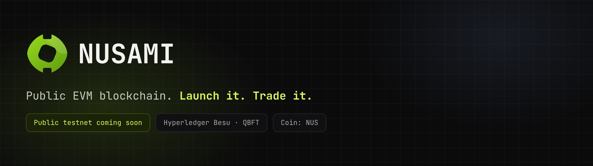

  

**NUSAMI is a public EVM blockchain with its own coin, NUS.** It runs on Hyperledger Besu (QBFT consensus) and comes with tools built into the network: a token launchpad, a DEX, a standard token creator, a token locker and a multisig wallet.

> **Status: test network.** A public testnet is coming. Test coins have no value. The contracts have not had an independent review yet. Nothing here is financial advice or a promise of any kind.

## What is here

| | |
|---|---|
| **Launchpad** | Create a token with a bonding curve and trade it right away. |
| **Token Creator** | Create a standard NUS-20 token with optional mint and pause. |
| **DEX** | Swap tokens and add liquidity. |
| **Token Locker** | Lock tokens until a date you choose. No owner, no admin. |
| **Multisig** | A shared wallet where several owners must confirm. Uses Safe contracts without changes. |
| **NUSAMIScan** | Block explorer for the network (in progress). |

## Links

- Website: https://nusami.xyz
- X: https://x.com/NUSAMIchain
- Docs: coming soon

## How we work

- One change at a time, each reviewed before it is merged.
- Reviews will be published when they exist.
- Be careful with copies. We will never ask for your seed phrase or private key.

---

Test network. Contracts have no independent review. You can lose all funds.
